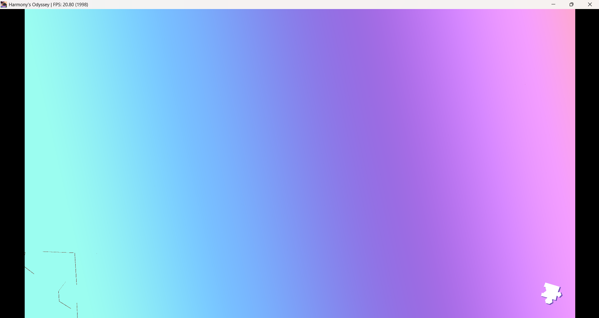

# About

Tool for automatic executables porting to Linux and Windows.

Includes a [relinker](core/relinker) that converts executable to the target system's native format and implementations of [system prx libraries](core/libs/prx) suitable for dynamic linking. No emulation or separate runtime process.

[Usage](docs/user/USAGE.md), [Build instructions](docs/dev/BUILD.md), [Architecture](docs/dev/ARCHITECTURE.md), [Technical debt of the project](docs/dev/TechnicalDebt.md), [code style conventions](docs/dev/CONVENTIONS.md), [contributing](CONTRIBUTING.md)

---

## Compatibility demonstration

### Harmony's Odyssey (PPSA16827)

Screenshots below are from the `harmony-odyssey-workaround` branch, which includes a minimal local workaround. They should be classified as **modified-branch screenshots**, not as strictly unmodified current-main results.

See `HarmonyOdyssey_PPSA16827.md` for the full compatibility report.
